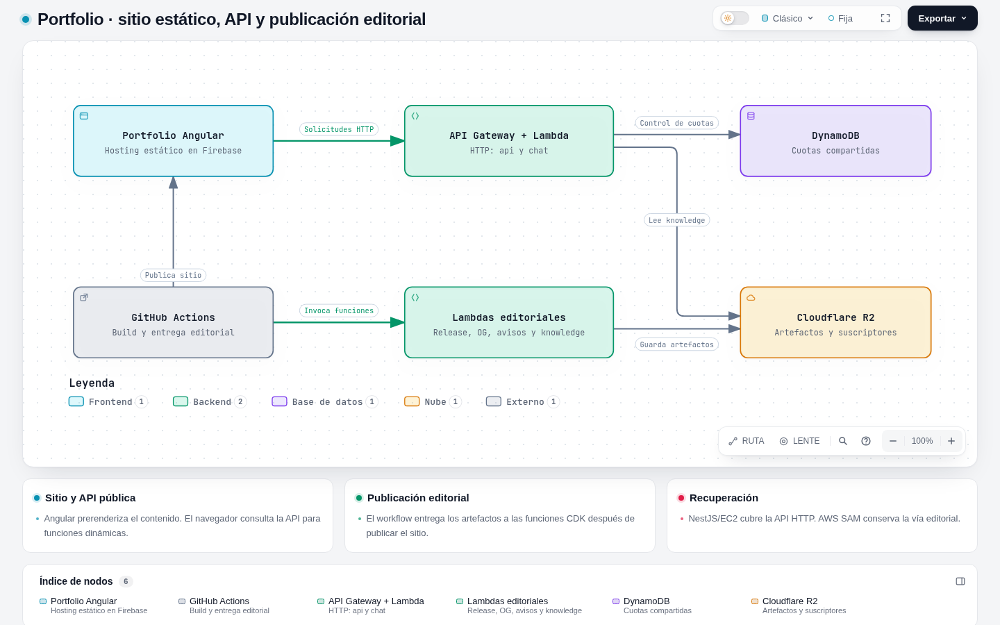

# Portfolio Platform

[English](README.md)

El portfolio entrega su contenido público como un sitio Angular estático. Un backend CDK/Lambda atiende las solicitudes dinámicas y ejecuta la publicación editorial después del build del sitio.

## Repositorios

- [`portfolio`](https://github.com/matigaleanodev/portfolio) — frontend Angular, contenido Markdown y workflow de publicación
- [`portfolio-api-cloud`](https://github.com/matigaleanodev/portfolio-api-cloud) — API HTTP principal y funciones Lambda editoriales
- [`portfolio-api`](https://github.com/matigaleanodev/portfolio-api) — implementación HTTP NestJS de recuperación
- [`portfolio-cloud`](https://github.com/matigaleanodev/portfolio-cloud) — implementación editorial AWS SAM de recuperación

## Arquitectura

[Resumen del sistema](docs/01-overview.es.md) · [Flujos y decisiones](docs/02-architecture.es.md) · [Fuentes técnicas](docs/04-evidence.es.md)

[Fuentes del diagrama](diagrams/README.es.md)
