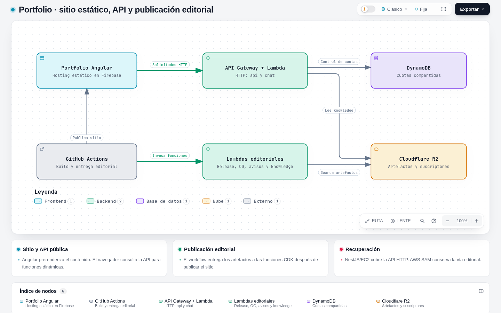

# Portfolio Platform

[Español](README.es.md)

The portfolio ships its public content as a static Angular site. A CDK/Lambda backend serves dynamic requests and runs editorial publication after the site build.

## Repositories

- [`portfolio`](https://github.com/matigaleanodev/portfolio) — Angular frontend, Markdown content and publication workflow
- [`portfolio-api-cloud`](https://github.com/matigaleanodev/portfolio-api-cloud) — primary HTTP API and editorial Lambda functions
- [`portfolio-api`](https://github.com/matigaleanodev/portfolio-api) — NestJS HTTP recovery implementation
- [`portfolio-cloud`](https://github.com/matigaleanodev/portfolio-cloud) — AWS SAM editorial recovery implementation

## Architecture

[System overview](docs/01-overview.md) · [Flows and decisions](docs/02-architecture.md) · [Technical sources](docs/04-evidence.md)

[Diagram sources](diagrams/README.md)
